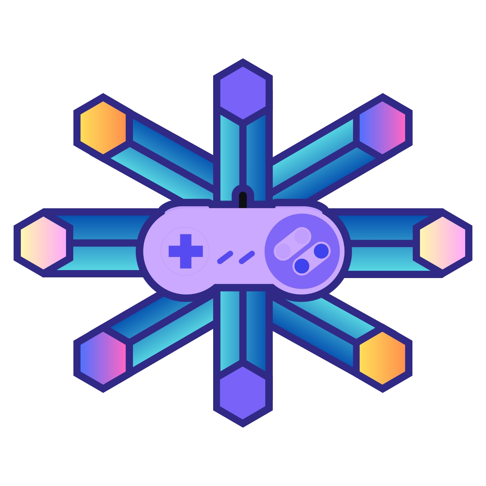

# Welcome to EmuCenter!

   

I made this highly customizable hub in order to have all of my retro games from different emulators ready to launch from just one place. This is the next generation of my original [EmuCenter](https://github.com/Maxsafer/emuCenter) (Python/Qt) — rebuilt with a modern UI, animated covers, automatic cover art, and a proper Windows installer, while keeping everything that made the original work: launch templates, custom scripts, controller navigation and the virtual controller.

I specifically made this for my need of having an emulator game hub for my Ayaneo Slide (handheld PC with a touchscreen).

# Table of Contents

1. [Download and Install](#-download-and-install)
2. [Setting up EmuCenter](#-setting-up-emucenter)
   - [Adding an emulator](#adding-an-emulator)
   - [Launch templates](#launch-templates)
   - [Cover art](#cover-art)
3. [How to use](#-how-to-use)
   - [Controller and keyboard bindings](#controller-and-keyboard-bindings)
   - [Virtual controller](#virtual-controller)
   - [Launching and closing games](#launching-and-closing-games)
4. [Settings reference](#-settings-reference)
5. [Tested emulators](#-tested-emulators)
6. [Running from source](#-running-from-source)
7. [Future development](#-future-development)

# !! Download-and-Install

Grab the latest `EmuCenter-Setup-x.x.x.exe` from the [Releases](../../releases) page and run it. No other software is required to browse and launch games.

> **Windows SmartScreen:** the installer is not code-signed (certificates are expensive for a free project), so Windows will show *"Windows protected your PC"*. Click **More info → Run anyway**. The source code is right here if you want to audit or build it yourself.

**Optional — virtual controller:** the *Virtual controller* feature (one stable controller that any physical pad drives, see [below](#virtual-controller)) requires the [ViGEmBus](https://github.com/nefarius/ViGEmBus/releases) driver by [nefarius](https://github.com/nefarius). Everything else works without it — if the driver is missing, EmuCenter simply tells you so in Settings.

Your library, settings and uploaded covers live in `%APPDATA%\EmuCenter`, so reinstalling or updating never touches your setup.

# !! Setting-up-EmuCenter

Everything is configured inside the UI — there are no configuration files to edit by hand anymore, and unlike the original there is **no required folder hierarchy**: your emulator `.exe` and your games folders can live anywhere.

## Adding an emulator

1. Press the **+** button (bottom right).
2. Fill in a name (e.g. `dolphin`) and a display name.
3. **Select Executable** — native file picker for the emulator `.exe`.
4. **Add Games Folder** — one or more folders containing your ROMs (native folder picker).
5. Optionally adjust the launch template and the excluded extensions (`.sav`, `.bin`, etc. are skipped by default).
6. Save — EmuCenter scans the folders and your games appear immediately.

Use **Settings → Manage Emulators** to edit, rescan or remove an emulator later, and **Settings → Sync All** to rescan everything at once.

## Launch templates

The template defines the CLI command used to launch a game, exactly like the original EmuCenter:

    exepath --flag1 -flagn game ?python:./scripts/customscript.py=param1 emupath,pre:somecommand=paramn

|Parameter|Use|
|--|--|
|exepath|Replaced with the emulator executable path|
|game|Replaced with the game file path|
|emupath|Replaced with the emulator's folder path (inside script hooks)|
|vcontroller|Replaced with the controller index to pass to custom scripts — set it in Settings, or let the virtual controller set it automatically|
|*optional* `?`|Prefix for extra commands/scripts to run around the launch. `pre:`/`post:` hooks run before/after; any other prefix (e.g. `python:`) runs pre-launch as `<runner> <script> <args>`|
|*commands* `,`|Between each command a single comma must exist|
|*script* `:`|Prefix to pass the custom script to run|
|*params* `=`|Prefix to pass parameters to a custom script|

Example — Dolphin fullscreen with a controller-binding script (Python required for `python:` hooks):

    exepath --config=Dolphin.Interface.ConfirmStop=False --config=Dolphin.Display.Fullscreen=True -b -e game ?python:./scripts/dolphin_p1_xinput.py=vcontroller

## Cover art

Covers are automatic, in this order:

1. **Local matching** — exact name, then normalized/franchise matching (a `pokemon.jpg` covers every Pokémon game without its own cover).
2. **IGDB** — if you add free [IGDB/Twitch API credentials](https://api-docs.igdb.com/#getting-started) in Settings, missing covers are fetched automatically.
3. **Manual upload** — hover a card and use the edit button to upload any image for that game.

# !! How-to-use

## Controller and keyboard bindings

Navigate the entire hub with a controller (D-pad or left stick) or the keyboard:

|Button|Key|Binding|
|--|--|--|
|A|Enter|Launches the selected game|
|B|Esc|Clears the selection; with nothing selected, asks to exit EmuCenter|
|X|T|Toggles the game info overlays (title + emulator badge)|
|Y|R|Toggles between sorting orders (alphabetical and emulator)|
|D-PAD / Left stick|Arrows|Navigates the game grid (hold to repeat)|
|START|I|Expands/collapses all sections (section headers are also clickable)|
|SELECT/BACK|F|Tags the selected game as a favorite|
|LB/RB|Q/E|Cycles the ALL, FAVORITES and RECENT tabs|
| |F11|Toggles fullscreen (also available as a header button)|

A navigation sound plays as you move — volume (or mute) is in Settings.

## Virtual controller

Enable **Virtual controller** in Settings and EmuCenter creates one stable virtual Xbox 360 pad (via ViGEmBus) that whichever physical controller you pick up automatically drives — with rumble passthrough. Configure your emulators against the virtual pad **once**, and any controller just works, no remapping. While it is enabled, `vcontroller` in launch templates automatically becomes the virtual pad's index. This has been super handy with Dolphin and YUZU/EDEN.

## Launching and closing games

Tap/click a game or press `A` on it. Most emulators can configure an exit hotkey — I set mine to exit on ESC, and my handheld has a custom button mapped to ESC, so closing a game drops me right back into EmuCenter.

To close EmuCenter itself: press `B` (with nothing selected) or the red power button in the header — both ask *"Are you sure?"* first (`A` confirms, `B` cancels).

# !! Settings-reference

|Setting|Use|
|--|--|
|Sort by|Games sorting order (alphabetical/emulator)|
|Simplified UI|Turns off cover art for weaker hardware|
|Game info on covers|Title + emulator badges over cover art (X / T)|
|Start in fullscreen|The app opens fullscreen on launch|
|Navigation volume|Navigation sound volume (0–100)|
|Virtual controller|The ViGEmBus aggregator pad (see above)|
|Preferred controller|Manual `vcontroller` index when the virtual controller is off|
|IGDB Integration|API credentials for automatic cover downloads|

# !! Tested-emulators

Carried over from the original EmuCenter — all of these launch fine with the right template:

xemu · xenia · project64 · visualboyadvance-m · dolphin · desmume · citra · yuzu · eden · ppsspp · duckstation · pcsx2 · rpcs3

# !! Running-from-source

For developers (end users: just use the installer):

    # backend
    cd backend && npm install && npm start
    # frontend (second terminal)
    npm install && npm run web        # dev server on http://localhost:8081

    npm run dist                      # builds the Windows installer into release/

Stack: Expo/React Native Web frontend, Express backend (scanning, launching, covers, native pickers), Electron shell. The virtual controller uses [ViGEmBus](https://github.com/nefarius/ViGEmBus) through `vigemclient` and `xinput-ffi`.

# !! Future-development

This was a fun project to develop and I intend to work on the interface/navigation or any bugs that are reported. 
[Support cool projects like this one! :)](https://www.paypal.com/donate/?hosted_button_id=SRATUX8VNHC9G)

# License

[GPL-3.0](LICENSE), same as the original EmuCenter.
